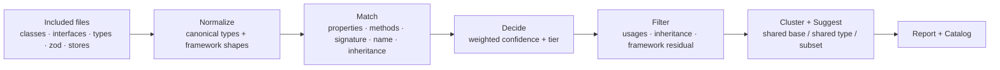

# @md-code/entities-uniqueness

ESLint rule and CLI that find semantically close **entities** — classes, interfaces, type aliases, object literals, factory functions, and framework shapes (zod schemas, mobx stores, redux/zustand state, class-validator models) — across a set of files.

Unlike a "duplicate a canonical component" tool, this analyzes the **whole included set against itself**: every entity is compared with every other, so you surface near-duplicates and extraction opportunities wherever they live.



## Quick start

```sh
bun add -D @md-code/entities-uniqueness
```

Generate the catalog once, then let the ESLint rule read it. The catalog is read from `reports/entities-catalog.json` and should be gitignored.

```sh
bunx md-code-entities-uniqueness --roots src/models:src/schemas
```

```js
// eslint.config.js
const plugin = require("@md-code/entities-uniqueness");

module.exports = [
  {
    files: ["src/**/*.{ts,tsx}"],
    plugins: { "md-code": plugin },
    rules: {
      "md-code/entities-uniqueness": ["error", {
        exportPath: "reports/entities-catalog.json",
        thresholds: { duplicate: 0.85, extract: 0.5, similar: 0.35 },
      }],
    },
  },
];
```

## How confidence is scored

Each pair of entities is scored on five signals, each in `0..1`:

| Signal | Weight | What it measures |
| --- | --- | --- |
| `properties` | 0.25 | Jaccard + overlap of property names, blended with type agreement |
| `methods` | 0.30 | Jaccard + overlap of method names |
| `signature` | 0.20 | Of shared methods, how many agree on canonical params + return type |
| `name` | 0.15 | Levenshtein + token overlap of the entity names |
| `inheritance` | 0.10 | Jaccard of `extends`/`implements` heritage |

**Two-pool model.** A signal that carries no information for a pair (e.g. two
entities with no methods) is *not* a neutral 1.0 — it reports
`hasEvidence: false` and scores 0. The `name` signal is always on (names always
exist); the other four participate only when they have evidence. The identity
budget (the `duplicate` threshold, 0.85 by default) is re-normalized over the
evidencing signals only, so a pair with no methods is judged on properties +
name alone instead of getting a free 0.30 from an empty methods set.

**Properties signal details.** The raw name overlap
(`0.6·jaccard + 0.4·overlap`) is blended with *type agreement* on the shared
names: when shared keys disagree on canonical type (`Record<K, string>` vs
`Record<K, number>`), at most half of the name-overlap score is kept. A
*small-shape discount* then pulls scores just under 1.00 when the union of
property names is tiny — two unrelated `{id, name}` seed records sharing two
generic fields is not a 1.00 match. The evidence object exposes
`jaccard`, `overlap`, `typeAgreement`, `aCount`, `bCount`, `union`.

**Shape extraction.** The normalizer surfaces the *real* shape of an entity:

- constructor parameter properties (`constructor(readonly from: string)`) are
  promoted to properties;
- numeric (`{1: ...}`) and computed keys are not semantic properties and are
  skipped;
- an object whose members are factory functions (`queryOptions: () => ({...})`)
  is scored on the **returned object's** members, not on a single `queryOptions`
  property — otherwise any two such objects would match at 1.00 on that one
  shared name.

Tiers:

| Tier | Range | Meaning |
| --- | --- | --- |
| `duplicate` | `≥ 0.85` | Near-duplicate — strong candidate to delete/merge |
| `extract` | `0.50 – 0.85` | Strong extraction candidate |
| `similar` | `0.35 – 0.50` | Weak similarity, informational |

Thresholds and weights are both configurable (see Options).

## What it reports

The ESLint rule fires on each entity that participates in a matched pair:

| messageId | Fires when |
| --- | --- |
| `duplicateEntity` | The entity is a near-duplicate of another (tier `duplicate` → error, `extract` → warn, `similar` → off) |

The report and catalog carry the full picture: every pair with **all five signal scores**, the clusters, and refactor suggestions.

## Refactor suggestions

Derived from clusters (strong candidates only — `duplicate` + `extract`), not from individual pairs:

- **shared-base** — 3+ entities share 2+ methods → extract a shared base class/interface.
- **shared-type** — 2+ entities overlap only on properties (no shared methods) → extract a shared type for the common fields.
- **subset-extraction** — one entity's fields are a strict subset of another's → extract the subset into its own type.

## Options

Read from the rule in `eslint.config.js` (rule `md-code/entities-uniqueness`) or a standalone `md-code-entities-uniqueness.config.js`; CLI flags override.

| Option | Default | Notes |
| --- | --- | --- |
| `roots` | `[]` | Directories to scan; required unless passed via `--roots` |
| `weights` | see table above | Per-signal weights |
| `thresholds` | duplicate 0.85, extract 0.50, similar 0.35 | Confidence cut-offs |
| `ignoredProperties` | `[]` | `string[]` of property/method names to ignore when scoring (e.g. `id`, `name`). Config-supplied only — the framework never invents a list. `ignoredMembers` is accepted as an alias. |
| `include` | `[]` | Only scan matching files |
| `exclude` | tests, stories, `*.d.ts` | Globs to skip |
| `ignoreDirs` | `node_modules`, `dist`, `build` | Extra directories to skip |
| `exts` | `.ts` `.tsx` `.js` `.jsx` | File extensions |
| `requireExported` | `false` | Only consider exported entities |
| `exportPath` | `reports/entities-catalog.json` | Where the catalog is exported to and read from |

## CLI

```sh
bunx md-code-entities-uniqueness [flags]
```

| Flag | Description |
| --- | --- |
| `--roots a:b` | **Required.** Colon-separated list of directories to scan |
| `--repo-root <dir>` | Repo root (default: auto-detected) |
| `--out <file>` | Catalog path (default `reports/entities-catalog.json`) |
| `--report [file.md]` | Write a Markdown report (default `reports/entities-similarity.md`) |
| `--check` | Exit 1 if any high-confidence duplicate pair is found |
| `--include a.ts:b.ts` | Only scan matching files |
| `--thresholds dup:ext:sim` | Confidence cut-offs, e.g. `0.85:0.55:0.35` |
| `--require-exported` | Only consider exported entities |
| `--config file` | Read rule options from a specific `eslint.config.js` or options file |
| `--log file` | Write a per-stage JSONL log (see below) |
| `--verbose` | Also list what the filters dropped and the full entity catalog |

### Stage log

`--log file.jsonl` writes one JSON line per stage, which makes it possible to
audit *why* a pair got its confidence:

| Stage | Contents |
| --- | --- |
| `pipeline:start` | roots, weights, thresholds, requireExported, ignoredMembers |
| `collector:after` | files scanned, entities per file |
| `normalizer:before` / `normalizer:after` | entity list before/after framework normalization |
| `matcher:before` / `matcher:after` | per pair: every signal's `score`, `hasEvidence`, and `evidence` |
| `decision:after` | per pair: confidence, tier, contributions, evidencing signals |
| `filter:before` / `filter:after` | pairs entering/leaving the filters (usages, inheritance, framework residual) |
| `pipeline:done` | totals: entities, duplicate/extract/similar pairs, clusters |

In the Markdown report, signals with no evidence render as `–` (not `0.00`),
so you can see at a glance which signals actually participated in a decision.

## Tests

```sh
bun --cwd entities-uniqueness add -D vitest   # once
bun --cwd entities-uniqueness run test
```

`tests/pipeline.test.ts` exercises extraction, tiers, clustering, suggestions, filters, thresholds and `ignoredMembers` through `main.run`; `tests/cli.test.ts` drives `main.js` end-to-end (help, error handling, full report + catalog, threshold override, stage log).
